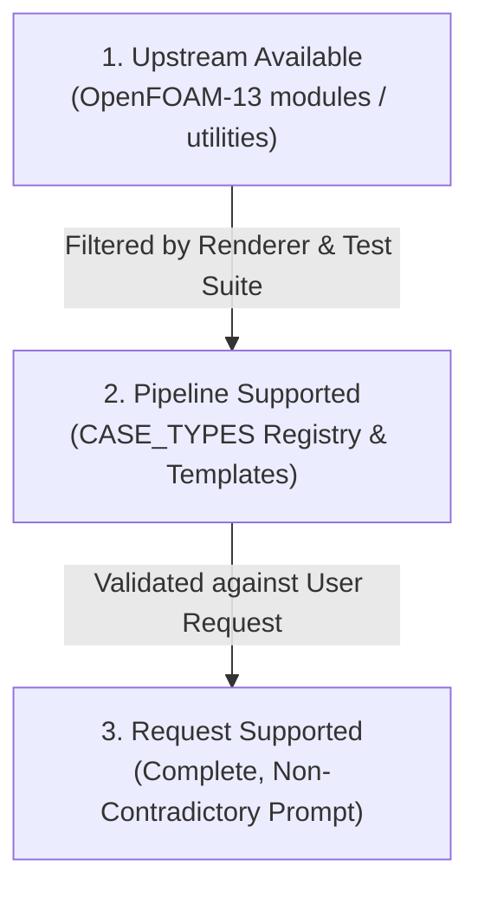

# OpenFOAM Foundation v13 Capabilities & Executable Evidence Roadmap

This document outlines the upstream OpenFOAM Foundation v13 utilities, modules, and diagnostic tools that inform the pipeline's deterministic validation, remediation registry, and Safe Exit boundaries.

---

## 1. The Three-State Capability Model

To prevent false claims of "unsupported physics" or unconstrained code generation, the pipeline distinguishes three capability states:

| State | Definition | Pipeline Action |
|---|---|---|
| **`upstream_available`** | OpenFOAM v13 contains a solver/module in `applications/modules/` (e.g. `multiphaseEuler`, `XiFluid`, `solidDisplacement`). | Informs future template expansion. Not automatically selectable unless implemented end-to-end. |
| **`pipeline_supported`** | Registered in `src/ir/case_types.py` (`CASE_TYPES`) with deterministic rendering, property lookup, and validation coverage. | Allowed for LLM selection and case generation. |
| **`request_supported`** | The user prompt provides sufficient, physically consistent boundary conditions and fluid properties for that `pipeline_supported` type. | Proceeds through generation and Docker validation ladder. |

> [!IMPORTANT]
> A feature being `upstream_available` does not license the LLM to hallucinate templates for untested solvers. Conversely, if a requested physics is neither `pipeline_supported` nor `upstream_available`, an `UNSUPPORTED_PHYSICS` Safe Exit is proven by citing prompt quotes alongside the `CASE_TYPES` lookup result.

---

## 2. Upstream OpenFOAM Utilities as Executable Evidence Producers

Rather than relying on LLM text interpretation, the pipeline leverages real OpenFOAM executable utilities inside the container (`microfluidica/openfoam:13`) to generate reproducible evidence:

### 2.1 Mesh Diagnostics (`checkMesh`)
- **Flags**: `checkMesh -allTopology -allGeometry -meshQuality -writeSurfaces -surfaceFormat vtk -writeSets -setFormat vtk`
- **Output Artifacts**: Parsed metrics (`MeshMetrics`: `min_volume`, `non_orthogonality_max`, `failed_checks`) and error surfaces in `postProcessing/`.
- **Safe Exit Policy**: Only non-positive volumes (`min_volume <= 0`) or fatal topology breakdowns constitute `CORRUPT_OR_UNCLOSED_MESH`. High non-orthogonality or skewness degrades to remediation signals.

### 2.2 Dictionary Inspection (`foamDictionary`)
- **Commands**: `foamDictionary <dict_path> -entry <entry_name> -value`
- **Role**: Deterministically asserts entry values before and after LLM dictionary patching (`patch_files`), verifying syntax without regex fragility.

### 2.3 Time Directory & Convergence Tracking (`foamListTimes`)
- **Commands**: `foamListTimes`
- **Role**: Verifies that time directories were actually written beyond $t=0$, confirming the solver advanced and did not exit prematurely.

---

## 3. Controlled Remediation Registry

OpenFOAM includes dozens of mesh and preprocessing utilities. Rather than exposing them as unconstrained actions, the pipeline operates against a versioned remediation registry:

| Remediation Key | OpenFOAM Utility | Prerequisites | Allowed Modifications | Failure Handling |
|---|---|---|---|---|
| `patch_dictionary_syntax` | `foamDictionary` / direct patch | `DICTIONARY_SYNTAX` failure class | `system/*`, `constant/*`, `0/*` | Max 3 attempts before intent rebuild |
| `regenerate_block_mesh` | `blockMesh` | Box geometry / declarative specification | `system/blockMeshDict` | Consumes attempt budget |
| `throttle_initial_timestep` | `_external_mesh_delta_t` | `SOLVER_RUNTIME` / high Courant | `system/controlDict` | Automatic adaptive scaling ($dt \approx 0.2 \cdot dx / V_{\max}$) |
| `relax_field_equations` | Solver relaxation | Diverging residuals in preflight/dry-run | `system/fvSolution` | Bounded within $(0, 1]$ |

---

## 4. Declarative Validation Contract

For case completion verification, the pipeline couples exit code checks with declarative function objects in `system/controlDict`:
1. **Solver Zero Exit & Non-NaN Residuals**: Solver completes without `FATAL ERROR` or floating-point exceptions.
2. **Output Time Directories Present**: `foamListTimes` detects expected checkpoint directories.
3. **Field Boundedness**: Quantitative metrics remain within physical envelopes (non-negative $k$, $\epsilon$, $\omega$, $p > 0$).
