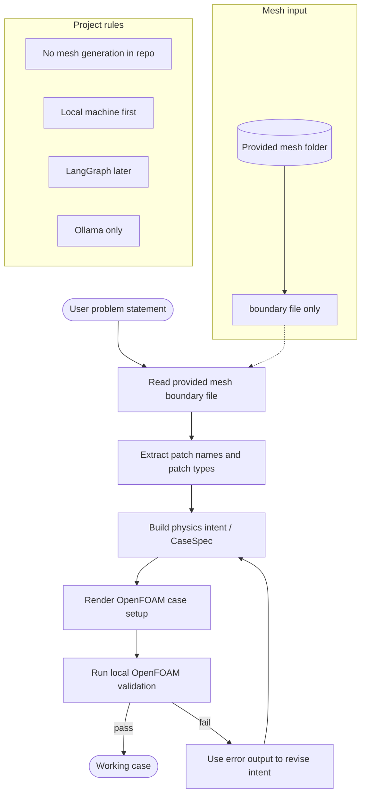

# New Workflow for the Provided-Mesh OpenFOAM Pipeline

This document captures the current working decisions for the project after the mentor discussion. It is the practical workflow we should follow from now on.

## Current decisions

- Scope: CFD case generation only.
- Mesh generation is out of scope for this repo.
- Cases will use meshes provided externally.
- The full mesh may be large, so the boundary file is the lightweight mesh summary we inspect first.
- Initial work stays local-machine only.
- The mentor's machine / VM situation is still undecided.
- Framework choice: LangGraph.
- Local backend: Ollama only.
- Check-ins: weekly.
- Work split with Malak is still undecided.

## What the pipeline should do

1. Read the user's case description.
2. Read the provided mesh boundary file to learn patch names and patch types.
3. Build the OpenFOAM case around that mesh.
4. Write only the case setup needed for the provided mesh.
5. Run OpenFOAM validation locally.
6. Use validation errors to improve the case until it runs.

## Mesh handling rule

We do not generate or repair the mesh itself.

The mesh input is treated as external and already supplied. For large meshes, we only inspect the boundary file first so we can understand:

- patch names
- patch counts
- whether a patch is `patch`, `wall`, or another type

Example mesh boundary source:

- `temp/provided-mesh/3D RHVT (OpenFOAM Files)/boundary`

## Proposed workflow

### System diagram

This is the diagram to use when you want the whole workflow at a glance. It matches the current decisions in this repo:

- provided meshes only
- boundary-file-first inspection
- case generation around the existing mesh
- local validation and retry
- no mesh generation
- LangGraph as the future orchestration layer

### 1. Input stage

- User provides the physical problem description.
- User provides or points to the mesh folder.
- The pipeline reads only the boundary file first.

### 2. Boundary understanding stage

- Extract patch names from the boundary file.
- Build the patch-role mapping for the case.
- Keep patch names consistent across every OpenFOAM dictionary.

### 3. Case assembly stage

- Generate the OpenFOAM case files for the provided mesh.
- Only write files needed for the case setup.
- Do not create blockMesh geometry or mesh generation scripts.

### 4. Validation stage

- Run the case locally with OpenFOAM.
- Use the validation output to detect missing fields, bad boundary conditions, or solver setup mistakes.
- Fix the case and retry.

### 5. Delivery stage

- Stop once the case runs successfully on the provided mesh.
- Document the final decisions and the working case layout.

## Suggested division of work

Since the mentor has not yet decided the split, a simple distributed workflow would be:

- One person owns mesh-boundary interpretation and patch mapping.
- One person owns physics and OpenFOAM dictionary setup.
- One person owns validation and retry logic.

This keeps the work parallel without overlapping too much.

## Immediate goal

The first concrete milestone is not a full platform. It is a single working case that:

- accepts the provided mesh boundary file,
- creates the required OpenFOAM case setup,
- and runs successfully on the local machine.

## Notes for later

- Once the first runnable case exists, the LangGraph wiring can replace the current plain Python flow.
- If the workflow expands later, we can add a clearer handoff between the mesh-boundary stage, physics stage, and validation stage.