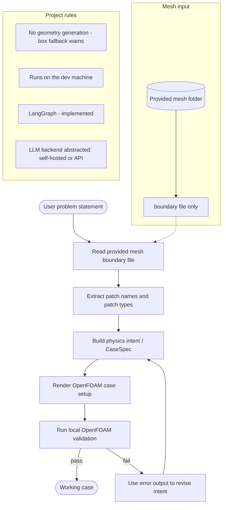

# Working Decisions — the Provided-Mesh OpenFOAM Pipeline

The practical workflow we follow. Kept current; for overall project state see
[`../supervision/project-status.md`](../supervision/project-status.md).

Last updated: **2026-08-18**.

## Current decisions

- **Scope:** CFD case generation only. (The "3D Modelling from 2D Drawings" title is void.)
- **Mesh: provided externally.** We do not generate or repair real geometry.
  A simple `blockMesh` box is available as a **fallback only** — see "Mesh handling rule".
- The full mesh may be large, so the boundary file is the lightweight mesh summary we inspect first.
- **Reference case:** the supervisor's RHVT mesh (see below).
- **OpenFOAM version: v13** (openfoam.org Foundation). Not ESI, not v9.
- **Framework: LangGraph** — implemented, not a future step (`src/orchestration/graph.py`).
- **LLM backend: abstracted.** One OpenAI-compatible client serves a self-hosted model
  (Ollama / llama.cpp) or a hosted API; swapping is configuration, not code.
- **Where it runs:** the current development machine. No VM dependency for now
  (`deploy/` exists for the isolated-VM case but is untested).
- **Phase:** finalising and drafting the report
  ([`../project/technical-report-outline.md`](../project/technical-report-outline.md)).
- **Work split:** joint with Malak; most implementation is Karim's.

## What the pipeline should do

1. Read the user's case description.
2. Read the provided mesh boundary file to learn patch names and patch types.
3. Build the OpenFOAM case around that mesh.
4. Write only the case setup needed for the provided mesh.
5. Run OpenFOAM validation locally.
6. Use validation errors to improve the case until it runs.

## Mesh handling rule

**We do not generate or repair real geometry.** The mesh is external and already supplied.

*Fallback:* the code can emit a simple `blockMeshDict` box (`scaffold_case`, and box mode
in the CLI). This exists for testing, demos, and trivial rectangular domains — it is
**not** a geometry capability, and using it should be reported as a warning rather than
treated as normal operation. Anything resembling real geometry must arrive as a
provided mesh. For large meshes, we only inspect the boundary file first so we can understand:

- patch names
- patch counts
- whether a patch is `patch`, `wall`, or another type

Reference mesh (supplied by the supervisor) — the case we test against:

- `temp/provided-mesh/3D RHVT (OpenFOAM Files)/` — Ranque-Hilsch vortex tube,
  ~10.6M faces. Boundary file: `.../constant/polyMesh/boundary`.
  Current state: the pipeline drives it end-to-end and the generated case **runs on 10
  MPI ranks with all residuals decaying** (verified 2026-08-18); pressure converges
  slowly. Further tuning is the end user's job. Residual table:
  [`../evidence/rhvt-residuals-2026-08-18.md`](../evidence/rhvt-residuals-2026-08-18.md).

## Proposed workflow

### System diagram

This is the diagram to use when you want the whole workflow at a glance. It matches the current decisions in this repo:

- provided meshes for real geometry (box fallback only for tests/demos)
- boundary-file-first inspection
- case generation around the existing mesh
- validation in Docker, with retry driven by the error output
- LangGraph as the orchestration layer (implemented)

### 1. Input stage

- User provides the physical problem description.
- User provides or points to the mesh folder.
- The pipeline reads only the boundary file first.

### 2. Boundary understanding stage

- Extract patch names from the boundary file.
- Build the patch-role mapping for the case.
- Keep patch names consistent across every OpenFOAM dictionary.

### 3. Case assembly stage

- Generate the OpenFOAM case files for the provided mesh.
- Only write files needed for the case setup.
- Do not create blockMesh geometry or mesh generation scripts.

### 4. Validation stage

- Run the case locally with OpenFOAM.
- Use the validation output to detect missing fields, bad boundary conditions, or solver setup mistakes.
- Fix the case and retry.

### 5. Delivery stage

- Stop once the case runs successfully on the provided mesh.
- Document the final decisions and the working case layout.

## Division of work

Joint deliverable with Malak, with most of the implementation carried by Karim. The
report is written under both names
([`../project/technical-report-outline.md`](../project/technical-report-outline.md)).

## Immediate goal

*Achieved:* a prompt plus a provided mesh produces a case that is rendered, audited,
mesh-checked and executed in Docker, with failures diagnosed and routed for retry.

*Current goal:* finalise and draft the report, and settle the RHVT convergence question.

## Notes for later

- RHVT runs with decaying residuals; pressure is the laggard and further tuning is out
  of scope. Archive the log **and** the config whenever a run behaves — case dirs are
  re-rendered in place and overwrite themselves, which nearly lost this result.
- A single self-hosted model run would confirm the backend abstraction in practice.
- `deploy/` supports the isolated-VM setup if that becomes a requirement again.