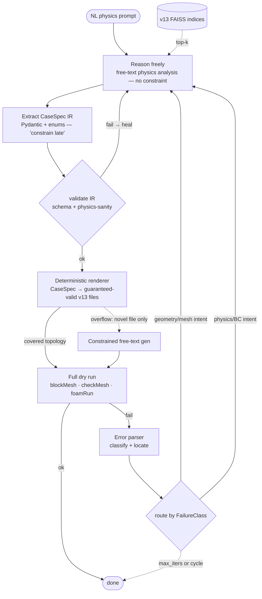

# Phase II Architecture: OpenFOAM Case-Generation Pipeline

Our engineering plan for the multi-agent pipeline (ConceptNote Phase II), grounded in a teardown of the existing LLM+OpenFOAM systems — above all **Foam-Agent** (RPI, NeurIPS 2025 ML4PS Workshop), the current published SOTA and the only one built on our exact stack (LangGraph + local-capable serving).

**Verification note.** The Foam-Agent claims below were checked against the primary source ([github.com/csml-rpi/Foam-Agent](https://github.com/csml-rpi/Foam-Agent), MIT, v2.1.0 / Apr 2026) on 2026-07-22, not taken from secondary summaries: `pyproject.toml` (`langgraph>=0.2`, `faiss-cpu`, `langchain-huggingface`, optional `ollama`), the README (embedding default, benchmark table, version scope), and the `src/` layout (`nodes/`, `mcp/`, `router_func.py`, `models.py`). Where a design point comes from a paper-only system (ChatCFD, OpenFOAMGPT) it is marked ⚠️ paper-only.

---

## 1. The one fact that reframes everything

**Every published system, Foam-Agent included, targets Foundation OpenFOAM v10 (or older). None targets v13.** Foam-Agent's README is explicit that only v10 is validated; its RAG corpus, prompt vocabulary, and error-parser regexes are all v10. We confirmed at the first meeting that **our project targets v13** (see [`first-meeting-prep.md`](first-meeting-prep.md)). So we cannot lift a prior system's knowledge base or prompts wholesale — the file names and run mechanics differ:

| v10 (all prior work) | v13 (us) | Where it bites |
|---|---|---|
| `constant/transportProperties` | `constant/physicalProperties` | `nu`, density |
| `constant/turbulenceProperties` | `constant/momentumTransport` | turbulence model |
| solver binary (`icoFoam`, `simpleFoam`, …) | `foamRun` + `solver <name>;` in `controlDict` | `system/controlDict`, `Allrun` |

We are in genuinely new territory on version. The architecture transfers; the corpus and vocabulary do not. **Action: build our RAG corpus fresh from the v13 tutorials we already cloned to `temp/openfoam-repo/` — never from a prior system's prebuilt index.**

The second reframing fact: **all published success rates use frontier models.** Foam-Agent hits 100% with Claude Opus 4.6; its own table shows the small-model cliff — Haiku 4.6 drops to **54.55% basic / 37.50% advanced**. Our hard constraint is a *local open-weight* model (no external API). We should expect to operate in Haiku territory or below, so every design choice below is chosen to compensate for a weaker model, not to chase the frontier-model numbers.

---

## 2. Reference architecture (what we build)

A LangGraph stateful graph — a validation-gated state machine, not a chat swarm. It keeps Foam-Agent's proven control-flow topology (plan → generate → validate → route-error → retry) but makes one deliberate departure from every published CFD-agent system, forced by our local-model constraint: **the LLM does not write raw OpenFOAM dictionary text. It emits a validated structured intermediate representation (a typed `CaseSpec`), and deterministic Python renders the guaranteed-valid v13 files.**

### 2.0 Why we depart from raw-text generation ("reason free, constrain late")

Every published system (Foam-Agent, MetaOpenFOAM, OpenFOAMGPT, ChatCFD) has the LLM write the dict files verbatim. That works *with frontier models* — and its success scales steeply with model strength (ChatCFD 82.1% on DeepSeek-R1 vs Foam-Agent 42.3% vs MetaOpenFOAM 6.2%, all same raw-text architecture). Our hard constraint is a weak local model, which is exactly where raw-text generation is most fragile: the dominant failure class becomes syntax/naming/dimension errors — wrong keyword spelling, `[0 2 -2 0 0 0 0]` vs `[1 -1 -2 0 0 0 0]`, v10-vs-v13 file names, cross-file patch-name drift.

The decisive evidence is [*The Constraint Tax* (2605.26128 ✅)](https://arxiv.org/abs/2605.26128), which measures exactly our regime (small models, structured output, executable correctness). Its key results: forcing valid structure via *hard* constrained decoding raises schema-validity to 100% but **drops executable accuracy** (a tool-call test lost 43.5 points — objects parseable but semantically wrong); and the winning pattern is **"reason free, constrain late"** — let the model solve the problem in free text, *then* deterministically package the result. So the lesson is not "avoid structure," it's **place the LLM/deterministic boundary correctly**: the model reasons about physics (its strength); code emits syntax (its strength, perfectly, every time). This also eliminates the single largest failure mode of all five published systems without any model improvement — we stop "building error-correction for errors a better architecture wouldn't produce."

### 2.1 The pipeline



Our three concept-note agents keep their names but change *what they emit* — intent, not files:
- **Meshing Agent** — decides geometry topology family (`box` / `cylinder` / `wedge` / `backstep` / `external_mesh`) + parameters; the renderer turns that into a correct `blockMeshDict`. It no longer writes vertex arithmetic by hand (§2.3).
- **Physics Agent** — decides solver, turbulence model, per-patch BC *intents*, fluid properties, scheme family; the renderer emits `0/`, `constant/`, `system/` from that.
- **Syntax-Validation Agent** — its job *shifts*: syntax is now guaranteed by the renderer, so this agent's value moves from catching dict-syntax errors to validating the **IR's physical sanity** (§2.2) and running the ladder. The "syntax validation" it was named for is largely designed out.

A **`CaseSpec`** (Pydantic) is the contract between them:
```python
class CaseSpec(BaseModel):
    solver: Literal["simpleFoam","pimpleFoam","buoyantPimpleFoam","interFoam", ...]
    turbulence_model: Literal["kOmegaSST","kEpsilon","SpalartAllmaras","laminar", ...]
    geometry_type: Literal["box","cylinder","wedge","backstep","external_mesh"]
    geometry_params: GeometryParams          # extents, cell counts, grading
    patches: list[PatchSpec]                 # name, type, BC intent, value
    fluid_props: FluidProperties
    schemes_family: Literal["firstOrder","secondOrder","boundedSecondOrder"]
    time_control: TimeControl
```
Because patch names live once in the IR and flow to every rendered file, **cross-file consistency is guaranteed by construction** — the biggest structural failure mode in raw-text systems (§3) simply cannot occur.

**Hybrid, not absolutist.** The renderer covers what it covers (tiers 1–3 below); genuinely novel files fall to an **overflow path** — constrained free-text generation for *that one file only*, after the renderer has written everything else. We keep raw-text generation as a scoped fallback, not the default.

Mapping to the scaffold (`src/agents/`): `llm_client.py` and `validation_agent.py`'s subprocess runner survive. The agents' `draft_*` methods change from returning file text to returning **IR fragments**; `case.py` is joined by a new deterministic **`renderer.py`** (IR → files); `orchestrator.py` becomes the LangGraph graph. Genuinely new: the RAG indices, the `CaseSpec` schema, and the renderer.

### 2.2 The validation ladder — leaner under the IR

**Principle: validate cheaply and early, heal locally before promoting — defense in depth, not one gate at the end.** The IR architecture changes *what* each rung catches. Because the renderer guarantees dict syntax, v13 naming, dimensions, and cross-file patch consistency, the entire class of syntax/naming errors that the ladder used to hunt for **is designed out**. Rung 1 is no longer "is this dict text valid?" — it is **"is this `CaseSpec` physically sane?"** Almost everything that now reaches the tool rungs is semantically meaningful, which is exactly what makes the signal useful (and, later, a clean RL reward — §9).

A node self-heals against the **cheapest validator that can catch its error class**, and only promotes once clean:

| Rung | Cost | Catches | Where |
|---|---|---|---|
| **1 — IR / physics-sanity** | free, in-process | invalid enum/type; Reynolds number vs turbulence model mismatch; geometry params out of range; BC intent invalid for a patch; solver↔turbulence incompatibility; unsupported `geometry_type` (→ route to overflow/STL path) | on the extracted `CaseSpec`, before rendering |
| **2 — Cheap tool (regression)** | seconds | rendered mesh won't generate (`blockMesh`) or is low quality (`checkMesh`) — now mostly catches *renderer/param* faults, not model syntax | after rendering |
| **3 — Full dry run** | expensive | physics/numeric inconsistency, solver dispatch, BC-solver incompatibility, divergence | terminal Runner |

**Self-healing routes to the reasoning step, at the IR level.** On a rung-1 failure the offending `CaseSpec` field is sent back to the **Reason/Extract** step with the specific violation named ("`turbulence_model: laminar` but Re≈5e4 — reconsider"). On a rung-3 failure the error parser classifies by `FailureClass` and routes geometry-vs-physics intent back to the owning agent. Heal loops are **bounded** (`max_heal` cap) and keep a **correction history** so the same IR fix is never retried — Foam-Agent's cycle detection, applied to the IR. Two nested scopes remain: a tight IR-validation loop (cheap, pre-render) inside the broader run-error loop (expensive, post-render).

In the scaffold: each agent grows `propose(...) -> IR_fragment` and `revise(prior_ir, errors) -> IR_fragment`; `validation_agent.py` is a library of tiered validators — **IR physics-sanity checkers** plus `blockMesh`/`checkMesh`/`foamRun` run **inside a Docker OpenFOAM v13 container** (`microfluidica/openfoam:13`, since the official Foundation images stop at v11). This is implemented and verified: `run_ladder()` executes the three rungs, and `parse_errors()` classifies + localizes failures to a file/line. **Docker replaces the isolated VM** for the run loop — a good case passes all rungs on real v13; a corrupted dict is caught and localized. Note the renderer moves work *out* of the model, so the error-parser (per FLARE) now matters most at rung 3.

### 2.3 Meshing verdict — never hand-write blockMeshDict

Geometry is where the IR decision pays off most, and the research is unambiguous:

- **Parametric topologies → renderer, always.** A box/channel/pipe/wedge `blockMeshDict` is fully determined by ≤10 numbers (extents, cell counts, grading). Generating its ~200 lines as free text is where a weak model most reliably fails (vertex arithmetic, edge directions, patch types, v12→v13 drift) — and all of it is one correct, verified-once renderer function. The starter library covers box/channel, cylinder (wedge), pipe, backstep, airfoil C-grid, bluff body — enough for tiers 1–3.
- **Complex geometry → don't generate it.** No current LLM architecture generates CAD/STL geometry; ChatCFD's benchmark explicitly excludes such cases. Accept **user-provided STL/mesh** as an input modality (`geometry_type: external_mesh` → `snappyHexMesh`/`fluentMeshToFoam`), and for the middle ground drive the **Gmsh Python API** deterministically from a geometry IR. The LLM picks parameters and refinement levels; it never emits triangulated geometry.

**Honesty about limits:** rung-1 catches *cheap* physics-sanity rules (Re vs turbulence model, params in range) but not deep numerical behaviour — a case can pass the IR check and still diverge, hit a Courant blow-up, or be subtly ill-posed. Those only surface at rung 3, and some need a full multi-timestep run we may choose not to pay for in the loop. The IR + renderer removes the *syntax* failure class; it does not remove the *physics* one. The ladder minimizes how often we reach the expensive rungs; it does not eliminate them.

---

## 3. Design decisions, best-of-breed

Each row: the choice, which system proved it, and why we adopt it.

| Decision | Source | Rationale |
|---|---|---|
| **Classify before you plan.** Planner first emits a Pydantic-validated `{domain, category, solver}` with allowed values injected as an enum, *then* decomposes into a file list. | Foam-Agent Architect | Hard-constrains the model's vocabulary before any file is written — kills hallucinated solver names at the source. |
| **Cross-file consistency by construction** — patch names, solver, dimensions live once in the `CaseSpec` and flow to every rendered file. | *Supersedes* Foam-Agent's predecessor-injection | Foam-Agent coaxes consistency by showing the model everything it already wrote (`sequential_dependency` mode) — necessary because it generates raw text. Our renderer makes the inconsistency *impossible*, deterministically. This was Foam-Agent's "most important structural decision"; the IR removes the need for it entirely. |
| **Hierarchical RAG: separate indices per concern** (case structure / file contents / execution scripts / command docs), routed by workflow stage. | Foam-Agent (4 FAISS indices + stage routing) | Beats a single monolithic store; stage routing raises retrieval precision. MetaOpenFOAM's single sparse index is cited as its weakness. |
| **Retrieved template is treated as ground truth; model modifies only what's needed.** | Foam-Agent Input Writer prompt | RAG is load-bearing, not decorative — see §4. |
| **Solver-name hard filter on retrieval** — never let a physically wrong template into context. | Foam-Agent `ValidateSolver` | A wrong template is worse than none for a weak model. |
| **Classify the error before routing the fix** (dimension mismatch vs missing file vs persistent vs general). | ⚠️ ChatCFD (paper-only) | Reduces the context the model must reason over when proposing a patch — disproportionately valuable for small local models. Feeds our `FailureClass` routing. |
| **Localize errors to a file + line, keep a correction history to break cycles.** | Foam-Agent error parser + history `H` | Implements the FLARE finding from our lit review (error *specificity* > retry *count*). History prevents the reviewer re-trying an identical failed patch. |
| **Pydantic validation at every node I/O boundary.** | Foam-Agent (MCP typed I/O) | Our LangGraph state schema; the first line of defence against malformed model output. |

---

## 4. RAG is not optional — it's load-bearing

The strongest cross-system evidence in the whole teardown: **MetaOpenFOAM scores 0% with RAG removed** (ablation), and **OpenFOAMGPT without RAG can only produce a 2D cavity** and nothing more complex. The models do not carry enough parametric OpenFOAM knowledge to write a correct case unaided; they *edit retrieved templates*. Two consequences for us:

1. The RAG corpus is a first-class deliverable, not a nice-to-have. Build it early (it's prototype priority #2, §6).
2. Because we're on a weaker local model, retrieval precision matters *more* than it did for the frontier-model papers — a weak model can't paper over a mediocre template. Tune for precision: `top-k` 3 (not 5), higher similarity threshold, exact solver-name pre-filter.

**Embedding model:** follow Foam-Agent's local default — `Qwen/Qwen3-Embedding-0.6B` via HuggingFace, runs on the VM with no API key. Consistent with our no-external-call constraint.

---

## 5. Adapting for a local open-weight model

The frontier→local gap is the project's central technical risk. Mitigations, in order of leverage:

The IR + renderer (§2) is itself the biggest mitigation — it moves syntax off the model entirely. What remains:

| Risk | Mitigation |
|---|---|
| **`CaseSpec` extraction drift** (small models add prose, drop keys, wrong enum) | "Reason free, constrain late": let the model reason in free text first, then a short extraction pass fills the IR. Local repair before Pydantic (strip fences, extract JSON span), then validate-and-retry with the violation message. The IR is small (~30 enum + ~10 numeric fields), so this is far easier than emitting whole dict files. |
| **Renderer coverage gaps** (case needs a file/topology the renderer doesn't cover) | The overflow path (§2): render everything covered, fall to constrained free-text for the one novel file. Track coverage explicitly; `geometry_type: external_mesh` routes complex geometry to STL/Gmsh (§2.3). |
| **Weak IR-revision quality** (still the highest reasoning demand) | On a run failure, give the reviser maximum specificity: the classified error + the implicated `CaseSpec` field + a retrieved similar-fix example + a narrow instruction ("Re≈5e4 with `turbulence_model: laminar` — pick a RAS model"). Revise the IR, not file text. |
| **Renderer correctness (new error class)** | The renderer is deterministic, so its bugs are *reproducible and testable* — unit-test each topology/solver family against golden v13 cases from `temp/openfoam-repo/`. A bug here is a code fix, not a model-tuning problem — a strictly better failure mode. |

---

## 6. Risk-ranked prototype order

Build in this order — each item de-risks the next, and #1–#2 need no VM (they run against a stub client / offline index):

| # | Component | Why first | Concrete first test |
|---|---|---|---|
| 1 | **Tier-1 deterministic renderer** (`CaseSpec` → v13 files) | The load-bearing bet of the whole IR architecture; if a renderer can reliably emit a runnable box/cavity case, the design is validated with *no model at all* | Hand-write a `CaseSpec` for the cavity; render; confirm `blockMesh && checkMesh && foamRun` all pass against the golden v13 tutorial |
| 2 | **IR extraction reliability** (NL → valid `CaseSpec`) | The one thing the local model must do well; replaces "can it emit a valid dict" | 20 NL prompts → measure valid-`CaseSpec` rate + physics-sanity pass rate; build the reason-free/constrain-late + repair loop |
| 3 | **v13 RAG corpus** | All prior corpora are wrong-convention; ours must be fresh; grounds the extraction step | Index `temp/openfoam-repo/` v13 tutorials; retrieval smoke tests ("incompressible laminar cavity", "turbulent pipe") |
| 4 | **v13 error parser** (rung 3) | `foamRun` error text differs from old solver binaries; Foam-Agent's regexes won't transfer | Collect 10–15 real v13 errors (bad dimension, divergence, bad BC); build the extractor; map error → `CaseSpec` field |
| 5 | **IR-revision on local model** | Highest reasoning demand: turn a run error into a corrected `CaseSpec` | Isolated: given error + implicated field + retrieved fix, measure revision correctness |
| 6 | **Renderer coverage expansion** | Extends tiers: cylinder/wedge, backstep, then Gmsh/STL path for complex geometry (§2.3) | Add each topology family; unit-test against golden v13 cases; wire the `external_mesh` path |

---

## 7. What we reuse, legally

| System | License | Use |
|---|---|---|
| **Foam-Agent** | **MIT** | Read and adapt freely. Highest-value files to study: the prompt templates (paper appendix + `src/nodes/`), the FAISS build (`init_database.py`), the LangGraph wiring and `router_func.py`. **Rebuild the corpus for v13; keep the HuggingFace embedding default.** |
| MetaOpenFOAM | **GPL-3.0** | Readable for ideas, but copyleft — do **not** copy code into our (intended-permissive) repo. Successor `sim-cli` — check its license before touching. |
| ChatCFD / OpenFOAMGPT v1 & 2.0 | not released | Paper-only. The ideas (ChatCFD's error taxonomy; the RAG-is-load-bearing evidence) transfer; there's no code to reuse. |
| **FoamBench** ([arXiv 2509.20374](https://arxiv.org/abs/2509.20374)) | — | 110-task benchmark — a candidate test suite once we produce runnable cases (adapt tasks to v13). |

---

## 8. Open questions this surfaces for the supervisor

- **VM/GPU** (already open) now has a sharper consequence: it decides Ollama vs vLLM/SGLang, which decides whether grammar-constrained decoding is viable (§5). Worth resolving before we lock the structured-output approach.
- **Which local model** to target — the next research step. The IR architecture *lowers* the bar (the model does classification + regression over a small vocabulary, not full dict generation), so a 7B–14B class model is plausibly enough — but it must be measured empirically (prototype #2 is exactly that measurement).
- Whether to adopt Foam-Agent's MCP tool interface wholesale or express tools as plain LangGraph nodes — a build-time call once we start #1.

## 9. Forward direction: RL / self-improving skills

The validation ladder (§2.2) is not only a correctness gate — it's an objective, automatable **reward signal**, which makes this pipeline an unusually good fit for reinforcement-learning-style self-improvement (learning a skill library, or fine-tuning the local model on validator-passing trajectories). This is an exploratory thread beyond the core plan; see [`rl-for-agent-skills.md`](rl-for-agent-skills.md). The IR architecture *sharpens* this: since the model now emits only the `CaseSpec` (not syntax), any RL reward gradient touches **semantic decisions only** — the reward reflects physics correctness, not keyword spelling, which is a strictly cleaner learning signal. The cheap near-term step it motivates — **log every `CaseSpec` + its validator verdict** — is worth doing regardless, as debugging data and as the exact dataset any later RL rung would train on.
