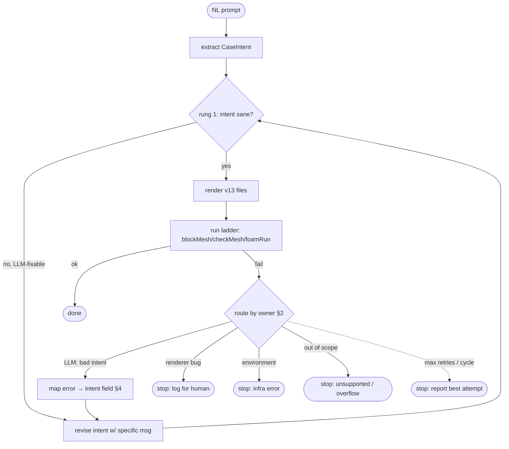

# Self-Correction Loop Design

Design for the concept note's "dry-run self-correction loop": run the generated
case, feed terminal errors back to the agents, and retry. This is a *design* doc
(research phase) — it settles how the loop should work before it's built.

Grounded in: the FLARE finding (error specificity > retry mechanism), the
Foam-Agent teardown (its Reviewer + history-based cycle detection), ChatCFD's
error-classification-before-routing, our validation ladder (`FailureClass` in
`src/agents/validation_agent.py`), and the errors the architecture spike actually
produced.

---

## 1. The loop corrects *intent*, not file text

Every published CFD-agent self-corrects by **patching the generated dictionary
text** — because the LLM wrote that text, errors live in it. Our architecture is
different: the LLM emits a compact `CaseIntent`; a **deterministic renderer**
owns all syntax. Two consequences reshape the loop:

1. **A case that reaches `foamRun` and fails is failing for *semantic/physical*
   reasons, not typos.** The renderer cannot emit a malformed keyword or a wrong
   dimension. So the loop's job is "fix the physics decision," never "find the
   broken bracket" — a strictly narrower, better-posed task for a weak local
   model. (Contrast Foam-Agent, whose Reviewer must first disambiguate a syntax
   slip from a physics mistake.)
2. **The correction target is the `CaseIntent` (or the expander inputs), then
   re-render.** We never hand-edit files in the loop. A revised intent
   re-renders to guaranteed-valid files, so a fix can never introduce a new
   syntax error — a whole class of "the fix broke something else" cascades is
   designed out.

---

## 2. Not every failure is the LLM's to fix (the routing decision)

**The central design question — and the one prior systems don't face.** Because
generation is split between a stochastic LLM and deterministic code, a failure
has one of four owners, and only one is a retry-against-the-LLM:

| Owner | Example | Correct action |
|---|---|---|
| **LLM — bad intent** | turbulence model wrong for the Reynolds number; `deltaT` too large → Courant blow-up; an incompatible/absent BC role; outlet pressure that makes the case ill-posed | revise `CaseIntent`, re-render, retry |
| **Deterministic code — renderer/expander bug** | a rendered dict is malformed; the expander emitted a wrong dimension or a wrong face-assignment | **stop and log for a human.** Retrying the LLM cannot fix *our* code |
| **Environment** | Docker down, image missing, run timed out (`FailureClass.ENVIRONMENT`) | **stop, surface the infra error.** Not a case error at all |
| **Out of scope — schema ceiling** | a geometry/solver the IR can't express | **stop, report "unsupported"** (or hand to the overflow path, `docs/phase-ii-architecture.md` §2) |

**A powerful detector falls out of the IR+renderer split:** a `DICTIONARY_SYNTAX`
failure means a **renderer bug**, not an LLM error — because the renderer is
supposed to make syntax errors impossible. (In the spike we had to *inject* a
missing semicolon to see this class; in production it should never come from a
correct renderer.) So `DICTIONARY_SYNTAX` routes to *humans/tests*, not to a
retry. This is the opposite of Foam-Agent, where a syntax error is the LLM's to
fix.

Misrouting matters twice over: it wastes the (few) retries a local model gets,
and — once RL is added (`docs/rl-for-agent-skills.md`) — it **poisons the reward
signal** by blaming the policy for a code bug. So routing correctly is not
optional polish; it's load-bearing for both the loop and the later RL.

---

## 3. The feedback message: specificity over mechanism (FLARE)

FLARE's finding — the *specificity* of the error fed back matters more than the
retry machinery — drives what the revise step receives. **Never the raw log.**
Instead a structured, IR-targeted message:

- the `FailureClass` and the rung it failed at,
- the **`CaseIntent` field implicated** (mapped from the OpenFOAM error, §4),
- the current value and a **targeted instruction**, e.g.
  *"Re ≈ 5e4 but `regime: laminar` — this needs a turbulence model; set
  `regime: turbulent`."* — not *"the simulation diverged, fix it."*
- the prior intent, so the model makes a **minimal** revision (not a rewrite),
- (later, with RAG) a retrieved similar-case fix as a worked example.

The validator already produces most of this: `parse_errors()` yields
`(FailureClass, file_hint, line, message)`. The missing piece is the
**error → intent-field mapping**, which is the real intelligence of the loop.

---

## 4. Error → `CaseIntent` field mapping

The loop's core table: translate a classified OpenFOAM failure into *which
intent decision to revise*. A starting map (to be grown empirically by running
real failures):

| Symptom / `FailureClass` | Likely intent cause | Revision |
|---|---|---|
| `SOLVER_RUNTIME`, "Courant number ... exceeded" / divergence early | `deltaT` too large, or first-order needed | lower `deltaT` (or switch numerics to upwind) |
| `SOLVER_RUNTIME`, residuals diverge over time | wrong/ill-posed BC combination; turbulence init too low/high | revise patch BC roles / turbulence estimate |
| `SOLVER_RUNTIME`, "keyword <field> not found" for a turbulence field | `regime: turbulent` but a field the model needs is absent | expander/coverage issue → check turbulence model support |
| `MESH_GENERATION` | bad box dims (zero/negative extent), or an impossible geometry | revise `box_size` / `cells` |
| `MESH_QUALITY` (checkMesh) | `cells`/grading too coarse or skewed | increase `cells`, add grading |
| BC/patch error ("incompatible", "not defined on patch") | a patch role that doesn't fit the physics, or a missing patch | revise patch `role`s |
| `DICTIONARY_SYNTAX` | **renderer bug** (see §2) | do NOT retry — log/test |
| `ENVIRONMENT` | Docker/infra | do NOT retry — surface |

Building this table honestly needs a **corpus of real failures** — which is
itself the RL trajectory data. So the loop and the RL dataset are the same
artifact viewed two ways.

---

## 5. Loop control

- **Cheapest rung first.** Validate the `CaseIntent` statically (rung 1: every
  patch covered, Re-vs-turbulence sanity, dims) *before* rendering/running, so
  the obvious mistakes never pay for a Docker run. Only physically-real failures
  reach rungs 2–3.
- **Two nested scopes** (from `phase-ii-architecture.md` §2.2): a tight,
  free static-validation loop on the intent inside the expensive run-error loop.
- **History + cycle detection.** Keep `(intent, error, revision)` triples;
  never re-apply a revision that already failed — Foam-Agent's history `H`,
  applied to intents. If a class of error recurs unchanged, break.
- **Bounded retries, tuned for a *local* model.** Foam-Agent uses 25 iterations
  *with a frontier model*; our local-model regime has fewer *productive* retries
  (the lit review flags diminishing returns). Start small (≈3–5) and measure;
  more retries mostly help only if each error message is specific (FLARE again).
- **Escalate, don't restart.** Route the fix to the smallest revision that can
  work; regenerate the whole intent only as a last resort.

---

## 6. Where it sits: the graph

In the (future) LangGraph implementation: nodes = extract / validate-intent /
render / run / route / revise; conditional edges on `FailureClass` + owner;
`recursion_limit` bounds the loop.

---

## 7. Connection to the RL / curriculum thread

The self-correction loop **is the RL data generator**. Each pass produces a
`(intent, reward)` trajectory (the ladder = reward, `docs/rl-for-agent-skills.md`).
Two design choices here pay off there:

- **Correct routing keeps the reward clean** — the policy is only credited/blamed
  for LLM-owned failures, never renderer bugs or infra.
- **A logged failure→fix corpus** (§4) is exactly the expert-iteration dataset,
  and its per-tier success rate feeds the automatic curriculum (SEC).

So building the loop's logging first is the cheapest step that serves both the
loop *and* the eventual RL — consistent with the "log every attempt + verdict"
recommendation already in the RL doc.

---

## 8. Open questions

- **How to detect a renderer bug vs LLM error reliably** when both can surface as
  a run failure? First cut: any syntax/parse class = renderer bug; anything the
  static intent-validator *should* have caught = validator gap; the rest =
  candidate LLM fix. Needs real failures to calibrate.
- **Retry budget for a local model** — empirical; measure productive retries per
  `FailureClass` once the loop runs.
- **When to give up vs escalate to full regeneration** — and whether to return
  the "best attempt" (furthest up the ladder) rather than nothing.
- **Whether `checkMesh` (rung 2b) failures are LLM-fixable** (cells/grading are
  intent) or better handled by a deterministic mesh-refinement heuristic.
